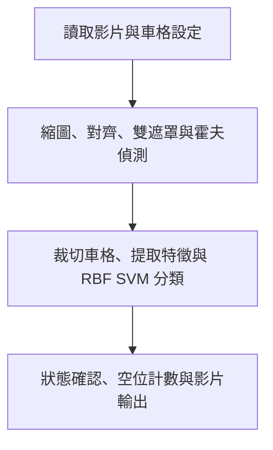
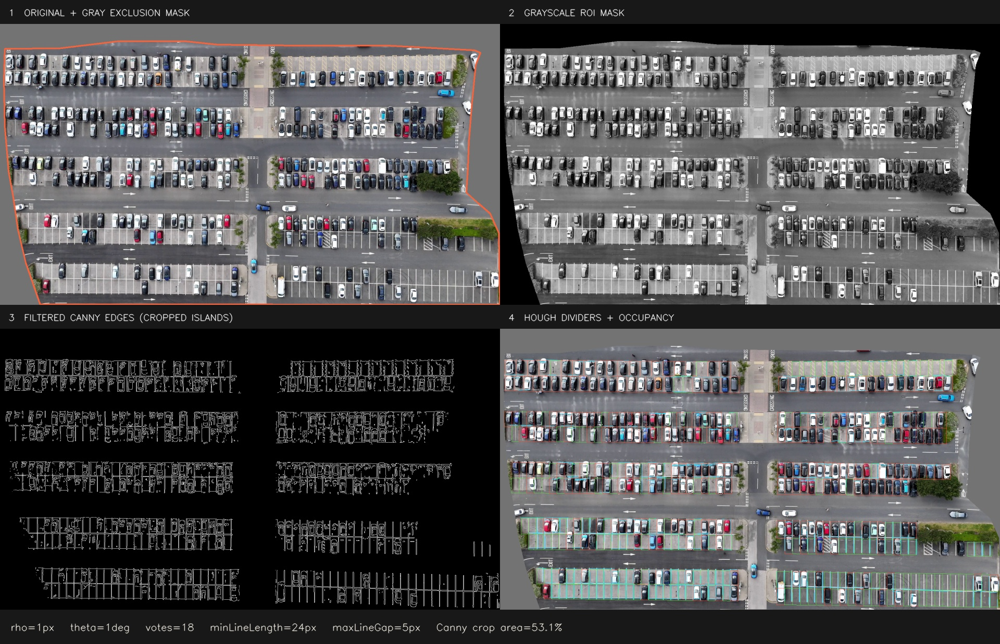

# 停車場空位辨識系統

使用 **Python、OpenCV 與 RBF Kernel SVM** 分析停車場影片，自動判斷已標定車格的佔用狀態，統計空位並輸出標記影片。

## 2. 專案簡介與特色（Features）

### 為什麼做這個專案？

停車場管理者若只觀看監視影像，需要逐格確認是否有車。本專案希望透過影像處理與機器學習，協助統計空位，讓使用者直接從畫面讀取車格狀態與數量。

### 主要功能

- **車格分類**：將車格分為空位、有車與待確認，並以不同顏色標示。
- **鏡頭對齊**：使用 ORB 特徵配對及 RANSAC 估計透視矩陣，修正輕微鏡頭位移。
- **雙遮罩預處理**：利用 ROI 與邊緣遮罩限制搜尋範圍，減少無關區域干擾。
- **霍夫線段輔助**：找出候選車格線，協助檢查低信心的空位結果。
- **HOG 與 RBF SVM**：從車格小圖提取形狀、明暗及顏色資訊，學習空位與有車的差異。
- **穩定計數與匯出**：確認狀態變化後更新計數，輸出 MP4、CSV 及模型檔。

### 整體流程



程式將每個車格內部統一成**寬 32×高 64 像素**的小圖，提取 **795 維特徵**：756 維 HOG、32 維明暗結構與 7 維統計特徵，再經標準化後交給 SVM。

## 3. 安裝與使用方法（How to Use）

### 執行環境

既有執行紀錄使用 Python 3.12、OpenCV 4.12 與 NumPy 2.2。不需要 GPU。

### 安裝套件

在專案資料夾開啟終端機並執行：

```bash
python -m pip install jupyterlab "numpy>=1.26,<2.3" "opencv-python-headless>=4.10,<5" pillow "imageio-ffmpeg>=0.5"
```

### 執行程式

1. 準備 `parking_rbf.ipynb` 與完整原始影片 `12125602_3840_2160_30fps.mp4`，放在同一個資料夾。
2. 啟動 JupyterLab：

   ```bash
   python -m jupyterlab
   ```

3. 開啟 `parking_rbf.ipynb`，檢查「使用者設定」區塊。
4. 選擇 **Run All／全部執行**，依序進行資料準備、模型訓練與影片推論。
5. 在 `OUTPUT_DIR` 指定的資料夾查看輸出影片與資料。

也可使用 VS Code 的 Jupyter 環境或 Google Colab 開啟 Notebook。原始影片需自行準備，請使用未加上分類框線的版本。

若原始影片放在其他位置，可在執行匯入區塊後調整：

```python
VIDEO_PATH = Path("/path/to/12125602_3840_2160_30fps.mp4")
OUTPUT_DIR = Path("./output").resolve()
```

### 重要參數

| 參數 | 預設值 | 說明 |
|---|---|---|
| `UNKNOWN_MARGIN` | `0.20` | 接受 SVM 決策值的門檻，並非機率 |
| `STABILITY_SECONDS` | `0.30` | 新候選狀態通常需持續的確認時間 |
| `DETECT_EVERY` | `3` | 每三幀重新分類一次 |
| `ALIGN_EVERY` | `6` | 正常情況下每六幀更新對齊 |
| `HOUGH_EVERY` | `6` | 霍夫處理更新間隔 |
| `OUTPUT_WIDTH` | `1920` | 輸出影片寬度 |

Notebook 已內建本次鏡位設定及初始標籤，Run All 會重新訓練模型。更換影片或攝影角度時，需同步更新車格座標、ROI 與訓練標籤，不能只修改輸入檔名。

## 4. 專案結構與檔案說明（Files / Folder Structure）

以下列出本專案的主程式、可搭配上傳的展示材料，以及執行後產生的檔案。實際儲存庫可依需要收錄教學版與展示檔。

| 檔案 | 類型 | 說明 |
|---|---|---|
| `README.md` | 專案文件 | 專案介紹與使用說明 |
| `parking_rbf.ipynb` | 主程式 | 包含前處理、特徵擷取、訓練、驗證與影片輸出 |
| `parking_rbf_explained.ipynb` | 教學版 | 加入逐行中文解說的 Notebook，可選擇收錄 |
| `12125602_3840_2160_30fps.mp4` | 輸入資料 | 本次原始影片，執行時需自行準備 |
| `parking_preprocessing.jpg` | 展示圖片 | 先前版本產生的四階段前處理對照圖，說明沿用的遮罩與霍夫流程 |
| `parking_program_demo_final.pptx` | 專題簡報 | 約五分鐘的程式展示簡報，可選擇收錄 |
| `parking_rbf_result.mp4` | 執行輸出 | 帶有車格標記與計數的完整結果影片 |
| `parking_rbf_counts.csv` | 執行輸出 | 各次分類更新的空位、有車與待確認計數 |
| `parking_rbf_model.xml` | 執行輸出 | 完整 OpenCV RBF SVM 模型 |
| `parking_rbf_scaler.json` | 執行輸出 | 特徵標準化設定及模型參數 |
| `parking_rbf_comparison.json` | 執行輸出 | 參數搜尋與保留畫面評估結果 |
| `parking_rbf_run_stats.json` | 執行輸出 | 幀數、耗時、處理速度與最終計數 |

輸出檔會在執行對應的 Notebook 儲存格後產生。CSV 每次分類更新記錄一列，並非每一個影格都記錄一列。

## 5. 結果與圖片（Results / Demo）

### 前處理展示

下圖呈現原圖加排除遮罩、灰階 ROI、過濾後的 Canny 邊緣，以及霍夫候選線與車格狀態。




### 結果影片

將結果影片一併上傳到相同資料夾後，可透過以下連結查看或下載：

[查看停車場空位辨識結果影片](parking_rbf_result_github.mp4)

也可以執行 Notebook，於最後的展示區塊查看播放器與結果截圖。

| 顏色 | 畫面意義 |
|---|---|
| 綠色 | 確認空位 |
| 紅色 | 有車 |
| 黃色 | 低信心或狀態變化，待確認 |
| 青色 | 霍夫候選線 |
| 灰色 | ROI 分析範圍外 |

### 已有運行成果

- 本次範例監測 **479 個車格**，完整處理 **910 幀、約 30.36 秒**的影片。
- 結果影片保留全部來源影格與原始播放 FPS，並顯示狀態標記及空位計數。
- 既有 CPU 執行紀錄整體約 **6.3 FPS**，實際速度依硬體與設定而異，尚未達來源約 30 FPS 的即時處理速度。

### 評估方式與限制

以 0、8、15、23 秒的畫面分組交叉驗證，搜尋 C 與 gamma，第 29 秒先保留作測試。評估同時比較逐格誤判數及空位計數誤差，避免不同方向的錯誤互相抵消。

初始標籤由 AI 協作整理，仍需獨立人工複核。不同時間可能包含同一格、同一台車，因此單一畫面或同影片驗證結果不能代表新場景的準確率。最終模型重訓時會納入第 29 秒，重訓後不可再將該畫面視為新的獨立測試。

後續改進方向包括增加經人工確認的樣本、建立獨立測試集，以及比較不同分類模型與推論效率。

## 6. 作者與聯絡方式（Author / Contact）

本專案由作者提出應用需求、功能規劃與優化方向，透過 **ChatGPT 協作**完成程式整合、鏡位及初始標籤整理、參數搜尋與展示文件製作。

**作者聯絡信箱：** [114104107@gms.tcu.edu.tw](mailto:114104107@gms.tcu.edu.tw)

如有使用問題、錯誤回報或改進建議，歡迎透過 Email 聯絡，或在 GitHub 儲存庫提出 Issue。

### 參考資料

- [OpenCV：SVM Class Reference](https://docs.opencv.org/4.x/d1/d2d/classcv_1_1ml_1_1SVM.html)
- [OpenCV：Hough Line Transform](https://docs.opencv.org/4.x/d9/db0/tutorial_hough_lines.html)
- [scikit-learn：Support Vector Machines](https://scikit-learn.org/stable/modules/svm.html)

SVM 實作使用 OpenCV，scikit-learn 文件作為概念參考。
